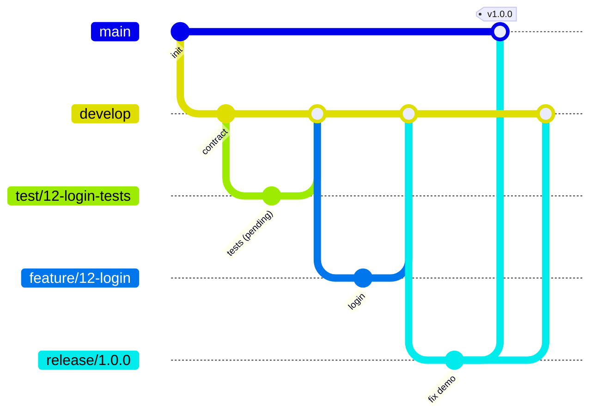

# Quy trình làm việc (Gitflow)

Kế hoạch, role và task của từng người: [docs/plan.md](docs/plan.md).

## Role

| Role | Thành viên | Trong quy trình |
| --- | --- | --- |
| Lead + core | Tân (`tankhangkm12`) | Viết contract; code store core; CI; approve và merge mọi pull request; tạo release và tag |
| Backend dev | Nhất (`duynhat1504`), Cường (`khongpc-ptit`) | Code feature trên `feature/*` |
| GUI dev | Nguyên (`khanhnguyn2709`) | GUI design trên `design/*`, code GUI trên `feature/*` |
| Test + GUI edge | Quân (`dvquan0516`) | Viết test độc lập trên `test/*`; test mọi pull request; code màn hình edge trên `feature/*` |

## Branch

| Branch | Ai dùng | Tạo từ → merge vào | Quy tắc |
| --- | --- | --- | --- |
| `main` | – | – | Protected. Chỉ nhận merge từ `release/*` hoặc `hotfix/*`; mỗi lần merge gắn tag |
| `develop` | – | – | Protected. Chỉ nhận pull request |
| `feature/<issue>-<ten-ngan>` | Dev, Tân | `develop` → `develop` | CI xanh + Quân comment "Test passed" + Tân approve |
| `test/<issue>-<ten-ngan>` | Quân | `develop` → `develop` | Test merge ở dạng pending cho tới khi feature xong |
| `design/<issue>-<ten-ngan>` | Nguyên | `develop` → `develop` | GUI design trong `docs/ui/`; Tân approve |
| `release/<version>` | Tân | `develop` → `main` + merge ngược về `develop` | Chỉ sửa bug; Quân chạy release test trên 5 laptop |
| `hotfix/<version>` | Tân | `main` → `main` + `develop` | Sửa gấp |

Ví dụ: `feature/23-dataserver-token-check`, `test/23-token-tests`, `design/8-stage1-mockups`, `release/1.0.0`.



## Vòng đời một task

1. Issue ở cột **Ready**; người được assign kéo sang **In progress**.
2. Tạo branch từ `develop`:
   ```bash
   git switch develop && git pull
   git switch -c feature/23-dataserver-token-check
   ```
3. Commit nhỏ theo **Conventional Commits**: `feat(dataserver): verify HMAC token`, `test(auth): login cases`, `docs(protocol): add ReadChunk fields`.
4. Push, mở pull request vào `develop` theo PR template, ghi `Closes #23`. Card sang **Testing**.
5. **Quân** test theo acceptance criteria của issue: bật test liên quan, chạy, comment **"Test passed"** hoặc mở issue Bug. Card sang **In review**.
6. **Tân** review, approve, **Squash and merge**. Issue tự đóng, card sang **Done**.

Board: Backlog → Ready → In progress → Testing → In review → Done.

## Review và approve

- Tân approve và merge mọi pull request của người khác.
- **Pull request của Tân:** GitHub không cho tác giả tự approve, nên Tân merge bằng **admin bypass** của ruleset. Chỉ bypass khi **CI xanh và Quân đã comment "Test passed"**. GitHub không tự kiểm tra điều này; đây là quy tắc của team.
- **Không ai tự test việc của mình:** Quân test mọi thứ trừ màn hình GUI do Quân làm; những màn hình đó do Nguyên test bằng GUI checklist.

## Contract

- Contract gồm `docs/protocol.md`, `docs/rbac.md`, message types trong `Dfs.Shared` và các interface `IMetadataStore`, `IAuthorizer`, `IDfsClient`.
- Chỉ **Tân** sửa contract. Mỗi lần sửa là một pull request riêng, có nửa ngày cho Cường, Nhất, Quân comment, và phải báo Quân vì test phụ thuộc vào contract.
- Dev cần thay đổi contract thì mở issue cho Tân, không tự sửa.

## Test độc lập

- Quân viết test từ contract và acceptance criteria, **không đọc code của dev** để thiết kế test.
- `tests/Dfs.AcceptanceTests` chỉ tham chiếu `Dfs.Shared` (contract), không tham chiếu server hay `Dfs.Client.Core`; test nói chuyện với hệ thống qua TCP như một client thật.
- Test được viết song song với code, merge ở dạng pending, rồi bật khi feature sẵn sàng. Feature chỉ được merge khi test của nó pass.
- Test fail: dev sửa code, không sửa test của Quân. Nếu spec chưa rõ, Tân quyết định và cập nhật contract.
- Dev vẫn có thể viết unit test nhỏ cho logic của mình trong project của mình.

## CI

Chạy trên mọi pull request vào `develop` và `main`; mọi bước phải xanh mới được merge:

1. Build solution.
2. Unit test.
3. Khởi động cluster Docker Compose và chạy acceptance test của Quân.
4. Kiểm tra link trong Markdown (`markdown-links`).

Không có CD: image được build tại máy bằng `docker compose up --build` (xem `docs/deployment.md`).

## Quy tắc chung

- Không push thẳng vào `main` hoặc `develop`.
- Một pull request = một issue. PR nhỏ, review nhanh (mục tiêu < 400 dòng).
- Sửa schema thì sửa `docs/data-model.md` trong cùng pull request.
- Quyết định kiến trúc lớn → thêm một file trong `docs/adr/`.
- Không commit secret (`TOKEN_KEY`, mật khẩu admin). Dùng file `.env` local, đã có trong `.gitignore`.
- Rebase branch lên `develop` mới nhất trước khi xin review nếu có conflict.

## Release

1. Cuối mỗi tuần, Tân tạo `release/x.y.z` từ `develop` (`1.0.0`, `1.1.0`, `1.2.0`, `2.0.0`).
2. Quân chạy demo script của tuần trên 5 laptop; bug sửa trên branch release.
3. Tân merge vào `main`, tạo tag `vx.y.z` bằng tay, rồi merge ngược vào `develop`.

## Thiết lập trên GitHub (owner)

- Ruleset "Protect main and develop": PR + 1 approval, required check `markdown-links` (thêm check build + test khi CI chạy lần đầu), chặn force push và xoá branch.
- Bypass list của ruleset: thêm **Repository admin**, chế độ **For pull requests only**.
- Default branch `develop`; bật Squash merging và "Automatically delete head branches".
