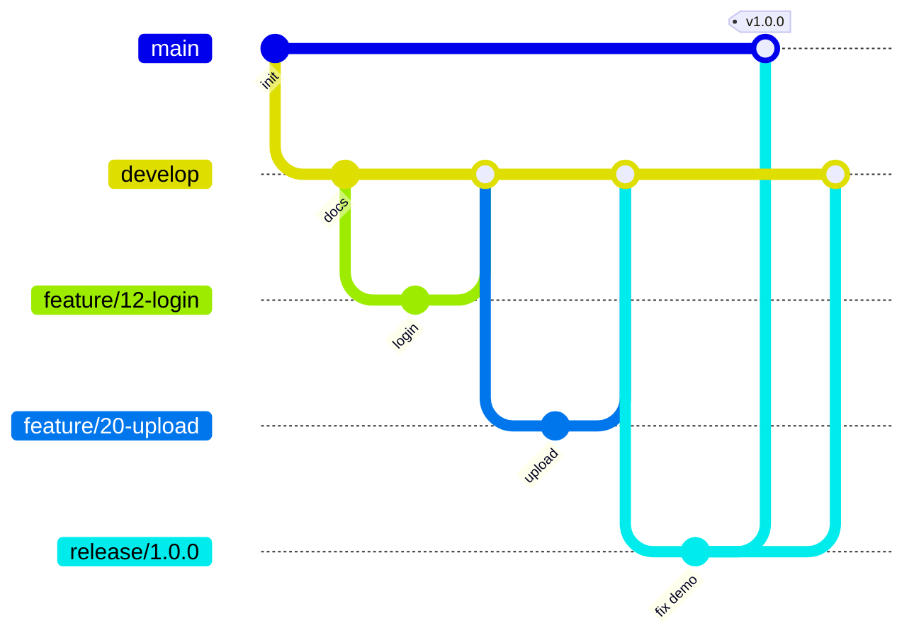

# Quy trình làm việc (Gitflow)

## Branch

| Branch | Mục đích | Quy tắc |
| --- | --- | --- |
| `main` | Code đã release, sẵn sàng demo | Protected. Chỉ nhận merge từ `release/*` hoặc `hotfix/*`. Mỗi lần merge gắn tag (`v1.0.0` = nộp stage 1, `v2.0.0` = stage 2) |
| `develop` | Nhánh tích hợp, luôn build được | Protected. Chỉ nhận pull request có 1 review + CI xanh |
| `feature/<issue>-<ten-ngan>` | Một task trên board | Tạo từ `develop`, merge lại vào `develop` bằng pull request |
| `release/<version>` | Đóng băng trước khi nộp / demo, chỉ fix bug | Merge vào `main` và merge ngược lại `develop` |
| `hotfix/<version>` | Sửa gấp trên `main` (ví dụ ngày demo) | Merge vào `main` và `develop` |

Ví dụ tên branch: `feature/23-dataserver-token-check`, `release/1.0.0`, `hotfix/1.0.1`.



## Vòng đời một task

1. Chọn issue ở cột **Ready** trên GitHub Project, tự assign, kéo sang **In progress**.
2. Tạo branch từ `develop`:
   ```bash
   git switch develop && git pull
   git switch -c feature/23-dataserver-token-check
   ```
3. Commit nhỏ, message theo **Conventional Commits**:
   `feat(dataserver): verify HMAC token`, `fix(client): retry on timeout`, `docs(protocol): add ReadChunk fields`.
   Scope thường dùng: `metadata`, `security`, `dataserver`, `sdk`, `ui`, `deploy`, `docs`.
4. Push và mở pull request vào `develop`, dùng PR template, ghi `Closes #23`.
5. Card tự chuyển sang **In review**. Cần **1 approve** (CODEOWNERS của phần bị sửa) + **CI xanh**.
6. Merge kiểu **Squash and merge**, xoá branch. Issue tự đóng, card sang **Done**.

## Quy tắc chung

- Không push thẳng vào `main` hoặc `develop`.
- Một pull request = một issue. PR nhỏ, review nhanh (mục tiêu < 400 dòng).
- Thay đổi protocol, RBAC hoặc schema phải sửa `docs/protocol.md`, `docs/rbac.md` hoặc `docs/data-model.md` **trong cùng pull request**, và cần approve của owner hai phía liên quan.
- Quyết định kiến trúc lớn → thêm một file trong `docs/adr/`.
- Không commit secret (`TOKEN_KEY`, mật khẩu admin). Dùng file `.env` local, đã có trong `.gitignore`.
- Rebase branch của mình lên `develop` mới nhất trước khi xin review nếu có conflict.

## Release

1. Lead tạo `release/x.y.z` từ `develop` khi milestone cuối của stage xong.
2. Chỉ sửa bug trên branch release. Chạy toàn bộ demo script trên 5 laptop.
3. Merge vào `main`, tag `vx.y.z`, rồi merge ngược vào `develop`.

## Thiết lập trên GitHub (owner organization làm một lần)

- Branch protection cho `main` và `develop`: require pull request, 1 approval, require review from Code Owners, require status checks, chặn force push.
- Default branch: `develop`.
- Bật "Automatically delete head branches".
- Cho phép **Squash merging** (tắt merge commit cho feature PR nếu muốn lịch sử gọn).
