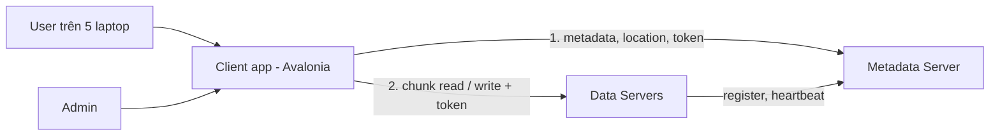
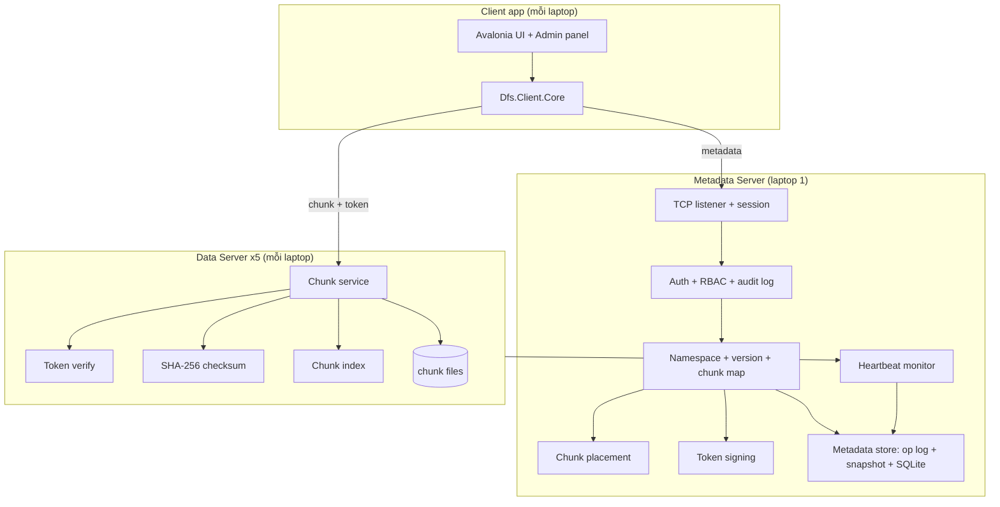
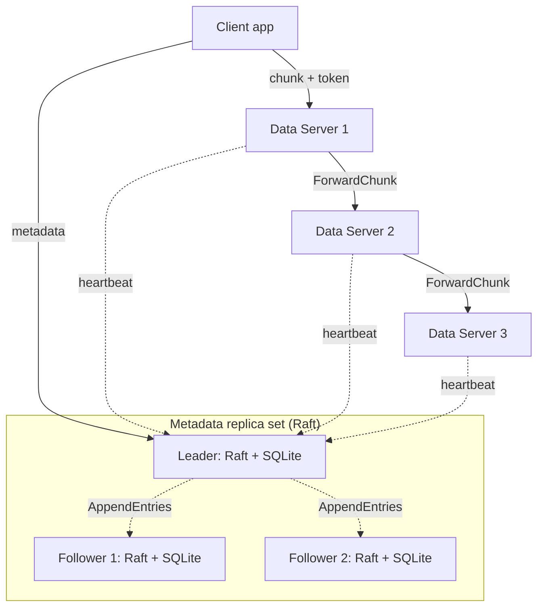

# Architecture

## Context

## Stage 1: MVP

Client hỏi Metadata Server chunk nằm ở đâu và nhận **signed token** cho từng chunk, sau đó đọc / ghi chunk **trực tiếp** với Data Server. Metadata Server không bao giờ chạm vào byte của file: nó chỉ quyết định quyền truy cập và ghi lại vị trí chunk.

Giới hạn của stage 1 (nêu rõ khi bảo vệ):
- Laptop chạy Metadata Server tắt → không ai mở được file.
- Một laptop Data Server tắt → các file có chunk trên đó tạm thời không đọc được.

## Stage 2: High Availability

Thay đổi so với stage 1:
- Metadata command đi qua Raft thay vì ghi thẳng vào op log; một thay đổi được commit khi 2/3 node có nó.
- Client và Data Server thử lần lượt 3 địa chỉ metadata và theo `NotLeader` redirect.
- `CreateUpload` trả về 3 Data Server cho mỗi chunk; client ghi vào server đầu, server này forward sang hai server còn lại (pipeline).
- Đọc chuyển sang bản sao khác khi Data Server chết hoặc checksum sai.
- Repair manager trên leader khôi phục đủ 3 bản sao.

Không đổi: token, RBAC model, UI, format lưu chunk.

### Vì sao hai cách replication khác nhau?

- **Metadata dùng consensus (Raft)** vì cần **strong consistency**: hai leader hiểu khác nhau về một file sẽ làm hỏng hệ thống.
- **Chunk không cần Raft**: chunk là write-once, có ID và checksum, và leader đã quyết định chỗ đặt từng bản sao. Copy đơn giản là đủ và nhanh hơn nhiều. GFS và HDFS cũng chia như vậy.

## Design rules (để stage 2 là nâng cấp, không phải viết lại)

1. **Mọi thay đổi metadata là một command**: `CreateFolder`, `CommitUpload`, `DeleteItem`, `SetGrant`, `CreateUser`… là record nhỏ, serialize được. Không có gì sửa SQLite ngoài việc apply command.
2. **Một đường duy nhất cho thay đổi**: mọi command đi qua một metadata-store boundary. Stage 1: ghi op log rồi apply vào SQLite. Stage 2: submit vào Raft, apply khi Raft commit.
3. **Command là deterministic**: ID, timestamp, password hash, vị trí chunk được quyết định *trước* khi ghi log và lưu sẵn trong command. Apply cùng command trên node nào cũng ra cùng kết quả.
4. **Op log là source of truth**: SQLite dựng lại được từ snapshot mới nhất + log sau đó. Test ở stage 1 bằng cách xoá file SQLite rồi restart.
5. **Endpoint luôn là list**: client và Data Server đọc danh sách địa chỉ metadata từ config (stage 1 một phần tử, stage 2 ba).
6. **Đọc metadata luôn từ leader** để client không thấy dữ liệu cũ.
7. **Chunk location là list**: stage 1 có một phần tử; stage 2 chỉ đổi replication factor trong config.
8. **Data Server không biết gì về user**: chỉ verify chữ ký token, nên thay đổi RBAC không đụng tới code Data Server.
9. **Mỗi node quảng bá địa chỉ truy cập được**: Data Server đăng ký bằng `ADVERTISE_HOST:PORT` (IP LAN của laptop), không bao giờ dùng IP nội bộ của Docker.

## Solution structure

| Project | Loại | Nội dung | Stage |
| --- | --- | --- | --- |
| `Dfs.Shared` | Class library | Message type, framing, `Hello`, token format, checksum, config model | 1 |
| `Dfs.MetadataServer` | Console app | Login, session, RBAC, namespace, version, chunk map, placement, token signing, heartbeat, op log, SQLite, audit log | 1 |
| `Dfs.DataServer` | Console app | Chunk read/write/delete, token verify, checksum, chunk index, register + heartbeat | 1 |
| `Dfs.Client.Core` | Class library | Kết nối, session, upload/download chunk song song, retry theo endpoint list | 1 |
| `Dfs.Client.Desktop` | Avalonia app | File browser, upload/download, version, share, admin panel | 1 |
| `Dfs.Fakes` | Class library | Fake Metadata Server, fake Data Server, fake client SDK | 1 |
| `Dfs.Tests` | Test project | Unit test của dev | 1 |
| `Dfs.AcceptanceTests` | Test project (Quân) | Black-box acceptance + failure test qua TCP, chỉ tham chiếu `Dfs.Shared` | 1 |
| `Dfs.Consensus` | Class library | Raft adapter (DotNext) sau metadata-store boundary | 2 |
| `deploy/` | Folder | Dockerfile, `docker-compose.yml`, `node.yml`, env mẫu, script firewall | 1 |
