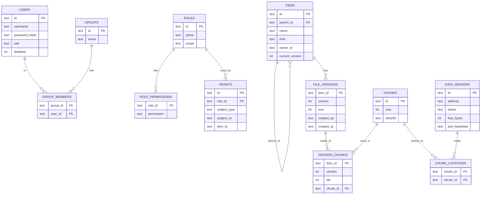

# Data model (draft)

> Bản nháp, sẽ chốt ở milestone M1.

## SQLite schema (Metadata Server)



Thêm các bảng: `SESSIONS` (token, user_id, expires_at), `UPLOADS` (upload đang dở), `AUDIT_LOG` (time, user, action, target, allowed). `GRANTS.item_id` = NULL nghĩa là system grant.

## Op log

- File append-only `oplog.jsonl`, mỗi dòng một command:
  ```json
  {"seq":1042,"type":"CommitUpload","at":"2026-11-20T09:15:02Z","data":{…}}
  ```
- Ghi + `fsync` trước, apply vào SQLite sau.
- Snapshot: copy file SQLite (SQLite backup API) kèm `lastSeq`. Khởi động = nạp snapshot + replay các dòng có `seq > lastSeq`.

## Chunk file (Data Server)

- Đường dẫn: `DATA_DIR/chunks/<2 ký tự đầu của chunkId>/<chunkId>.chunk`
- Local index: `DATA_DIR/index.db` (SQLite nhỏ) lưu `chunkId, size, sha256`, dùng cho `ChunkReport` sau khi restart.
- Ghi vào file tạm rồi rename, để không bao giờ có chunk ghi dở.
