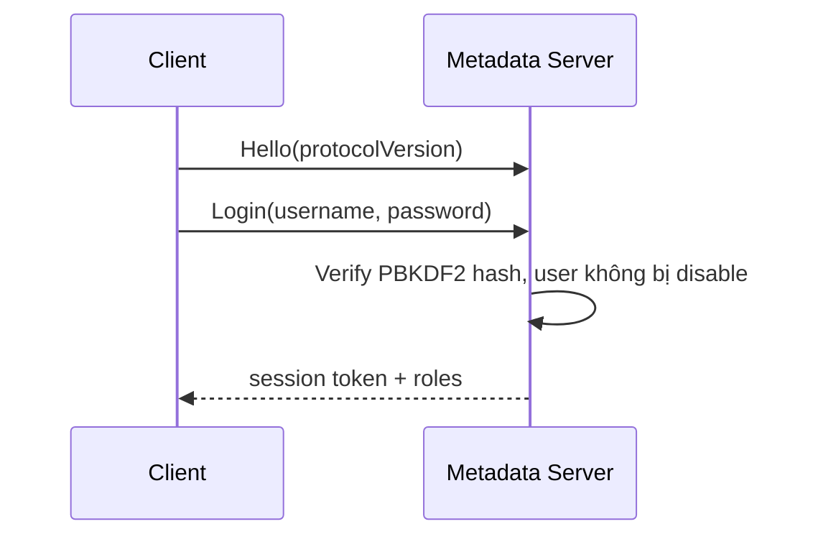
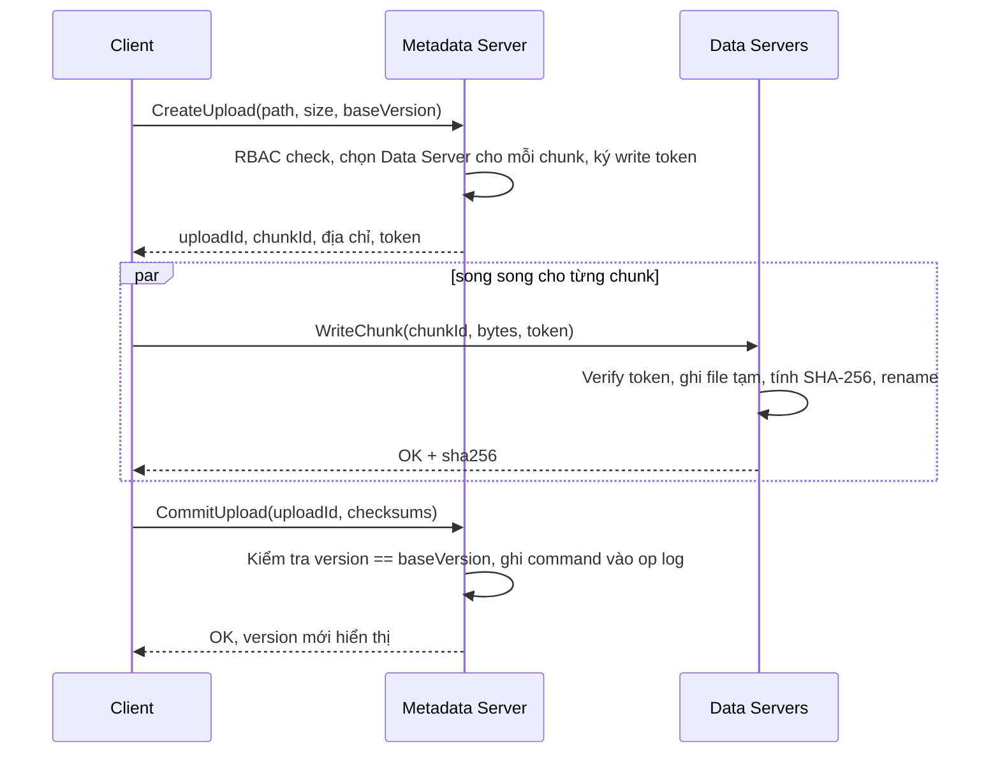
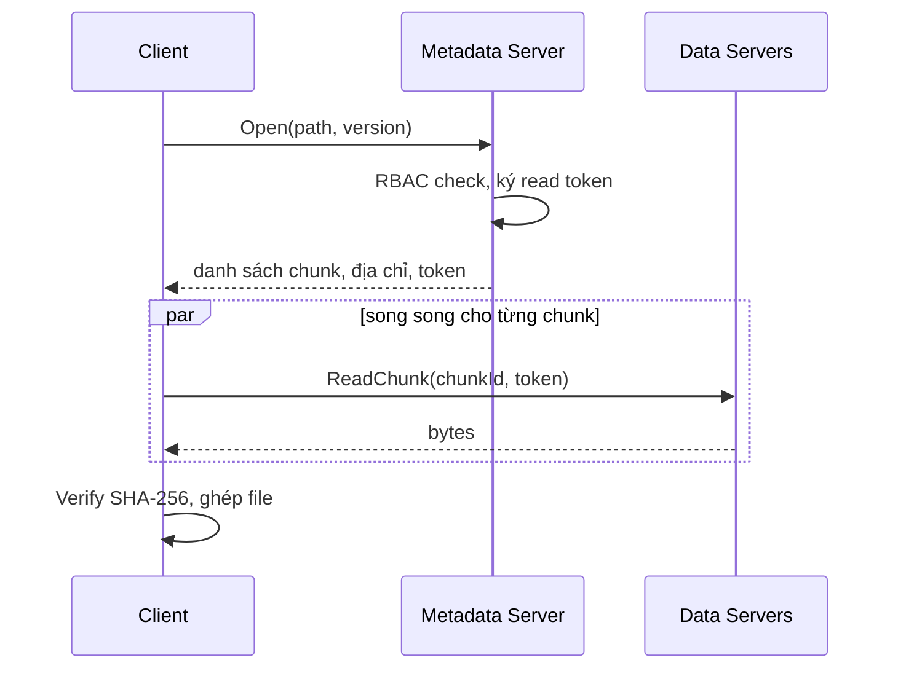
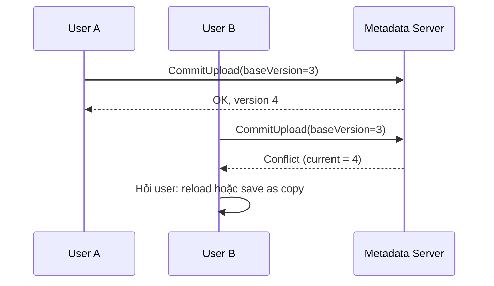
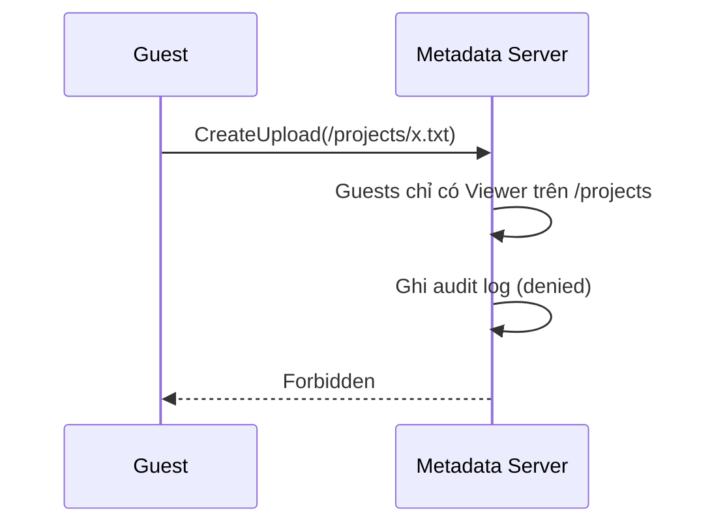
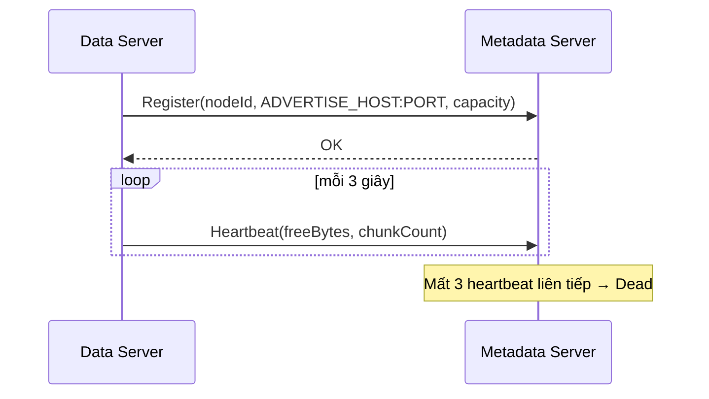

# Flows

## Login

## Upload (file mới hoặc version mới)

Chunk của upload không bao giờ commit sẽ bị garbage collection xoá sau timeout.

## Download

## Save conflict

## Permission denied

## Data Server tham gia cluster

Stage 2 sẽ bổ sung: leader failover, replication pipeline, re-replication.
