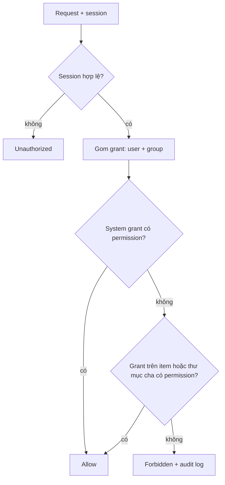

# Login và RBAC

> Owner: Security.

User đăng nhập bằng username + password. Mỗi request được kiểm tra dựa trên các **role** được cấp cho user (trực tiếp hoặc qua **group**), ở phạm vi toàn hệ thống hoặc trên một thư mục / file.

## Khái niệm

| Khái niệm | Ý nghĩa | Ví dụ |
| --- | --- | --- |
| User | Tài khoản đăng nhập; password lưu dạng hash PBKDF2-SHA256 có salt; có thể bị disable | `an.nguyen` |
| Group | Tập hợp user; grant cho group áp dụng cho mọi thành viên | `Team A`, `Guests` |
| Permission | Một hành động hệ thống kiểm tra | `file.read`, `user.manage` |
| Role | Tập permission có tên, tạo / sửa trong admin panel | `Viewer`, `Editor`, `Auditor` |
| Grant | Role + subject (user hoặc group) + scope (toàn hệ thống, hoặc một thư mục / file) | `Team A` là `Editor` trên `/projects/dfs` |

## Permissions

| Scope | Permissions |
| --- | --- |
| System | `user.manage`, `group.manage`, `role.manage`, `cluster.view`, `cluster.manage`, `audit.view` |
| Thư mục / file | `item.list`, `file.read`, `file.write` (lưu version mới), `item.create`, `item.rename`, `item.delete`, `item.share` (cấp role trên item đó), `version.manage` |

## Built-in roles

| Role | Scope | Permissions |
| --- | --- | --- |
| Admin | System | Tất cả |
| Auditor | System | `cluster.view`, `audit.view` |
| Owner | Thư mục / file | Tất cả permission của thư mục / file |
| Editor | Thư mục / file | list, read, write, create, rename, delete |
| Viewer | Thư mục / file | list, read |

Admin có thể tạo thêm role trong admin panel. Người tạo thư mục / file tự động là **Owner** của nó.

## Kiểm tra một request

1. Session token → user. Từ chối nếu session hết hạn hoặc user bị disable.
2. Gom grant của chính user + grant của mọi group user thuộc về.
3. Cho phép nếu một system grant có permission đó, hoặc một grant trên item **hoặc bất kỳ thư mục cha nào** có permission đó (grant kế thừa xuống cây).
4. Ngược lại từ chối và ghi vào **audit log**.

Stage 1 chỉ có grant cho phép (allow). Rule deny và "ngừng kế thừa" trên thư mục là tuỳ chọn stage 2.

## Session và data token

- Login trả về session token ngẫu nhiên, lưu phía server kèm thời hạn (8 giờ). Mọi request tới Metadata Server mang session token.
- Data Server không bao giờ thấy session. Với mỗi chunk, Metadata Server cấp cho client một **data token** (xem `protocol.md`) ký bằng HMAC.
- Admin đầu tiên được tạo từ config (`ADMIN_USER`, `ADMIN_PASSWORD`) ở lần khởi động đầu.
- Stage 1 gửi mọi thứ qua TCP thường trong LAN, kể cả password. TLS (`SslStream`) là tuỳ chọn stage 2; ghi rõ là **known limitation** trong báo cáo.

## Admin panel

Các màn hình admin chỉ hiện với user có role phù hợp:

- **Users**: tạo, disable, reset password, gán group
- **Groups**: thêm / bớt thành viên
- **Roles**: tạo role và tick permission
- **Grants**: chọn thư mục / file, thêm user hoặc group với một role
- **Cluster**: Data Server, dung lượng, số chunk
- **Audit log**: ai làm gì, lúc nào, được phép hay bị từ chối
