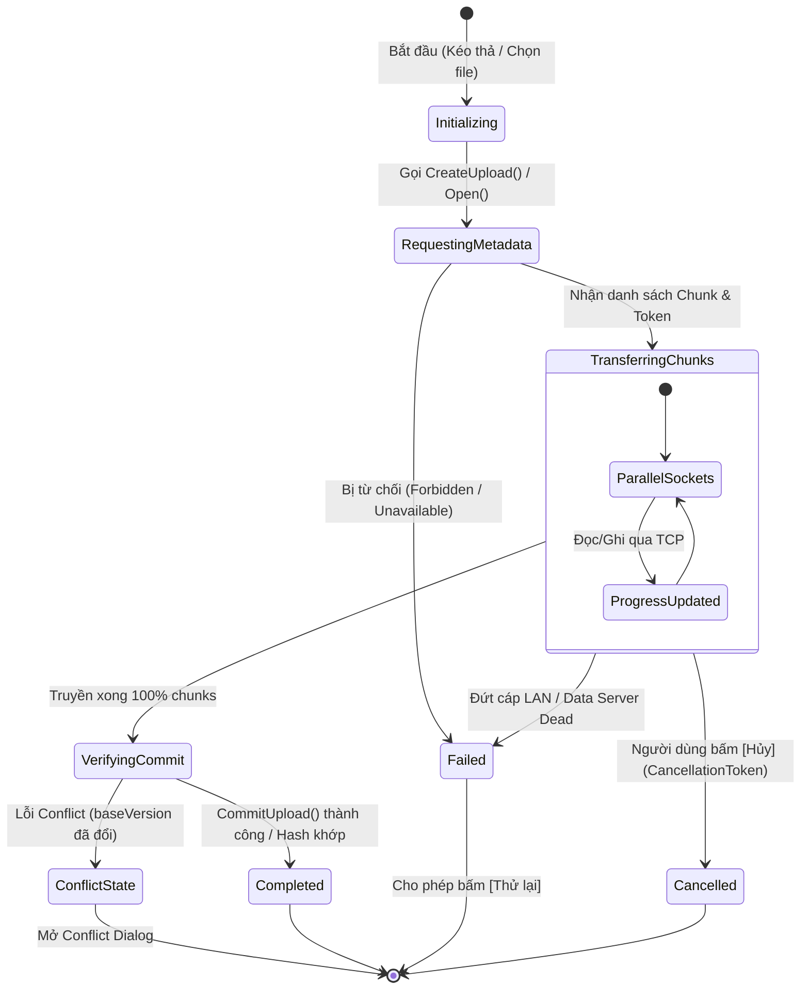

# Quản lý truyền tải Tải lên / Tải xuống (Transfer Manager View)

> Thuộc giai đoạn **Stage 1 (MVP)** – Yêu cầu: **FR-04, FR-05**, liên kết với nhiệm vụ **[M2-12]**.

---

## 1. Mục tiêu màn hình
Cung cấp bảng điều khiển trung tâm để người dùng theo dõi trạng thái, tốc độ và tiến độ của các hoạt động truyền tải tệp tin phân tán (Upload/Download). Cho phép hủy ngang thao tác khi cần thiết và hiển thị minh bạch việc phân mảnh các chunk 4 MB tới 5 Data Server trong mạng LAN.

---

## 2. Wireframe trực quan (ASCII Mockup)

```
+---------------------------------------------------------------------------------------------------------+
| Centralized Distributed File System (DFS) - Hàng đợi truyền tải                               [-] [o] [x]|
+---------------------------------------------------------------------------------------------------------+
| [Logo DFS]  | HÀNG ĐỢI TRUYỀN TẢI DỮ LIỆU            | Tốc độ tổng: 12.5 MB/s       | [an.nguyen v] [Thoát]|
+---------------------------------------------------------------------------------------------------------+
| Bộ lọc: [ Tất cả (3) ]  [ Đang truyền (2) ]  [ Hoàn thành (1) ]  [ Lỗi (0) ]     | [ Xóa mục đã xong ]   |
+---------------------------------------------------------------------------------------------------------+
|                                                                                                         |
|  [UP] report_final_v4.pdf                                                         [ Hủy truyền tải (X) ]|
|  Đích: /projects/dfs/report_final_v4.pdf | Dung lượng: 10.0 MB (3 chunks)                              |
|  Tiến độ: [============================================                  ] 70%  (7.0 MB / 10.0 MB)      |
|  Tốc độ: 4.2 MB/s | Ước tính: còn 1 giây | Trạng thái: Đang truyền các khối dữ liệu...                  |
|  +-- Chi tiết phân tán các Chunk:                                                                       |
|      * Chunk 0 (4 MB) -> Data Server 1 (192.168.10.11:7001) : [====================] 100% (SHA-256 OK) |
|      * Chunk 1 (4 MB) -> Data Server 3 (192.168.10.13:7001) : [==============      ]  75%              |
|      * Chunk 2 (2 MB) -> Data Server 5 (192.168.10.15:7001) : [========            ]  35%              |
|                                                                                                         |
|---------------------------------------------------------------------------------------------------------|
|                                                                                                         |
|  [DOWN] big_dataset_archive.zip                                                   [ Hủy truyền tải (X) ]|
|  Nguồn: /shared/big_dataset_archive.zip -> C:\Users\Nguyen\Downloads\big_dataset_archive.zip           |
|  Dung lượng: 50.0 MB (13 chunks)                                                                        |
|  Tiến độ: [====================                                          ] 32%  (16.0 MB / 50.0 MB)     |
|  Tốc độ: 8.3 MB/s | Ước tính: còn 4 giây | Trạng thái: Đang đọc song song từ 5 Data Servers             |
|                                                                                                         |
|---------------------------------------------------------------------------------------------------------|
|                                                                                                         |
|  [V-OK] presentation_slides.pptx                                                         [ Mở thư mục ] |
|  Đích: /projects/dfs/presentation_slides.pptx | Dung lượng: 4.5 MB (2 chunks)                           |
|  Tiến độ: [==============================================================] 100% (Đã hoàn tất)           |
|  Thời gian: Hoàn tất lúc 16:42:10 | Mã băm toàn vẹn: SHA-256 Verified [v]                               |
|                                                                                                         |
+---------------------------------------------------------------------------------------------------------+
| Đang hoạt động: 2 tác vụ | Tổng tải lên: 4.2 MB/s | Tổng tải xuống: 8.3 MB/s                            |
+---------------------------------------------------------------------------------------------------------+
```

---

## 3. Cấu trúc thẻ truyền tải (Transfer Card Anatomy)

Mỗi tác vụ truyền tải được hiển thị trong một khung dạng Thẻ (Card) độc lập với các thông tin chi tiết:

1. **Biểu tượng chiều truyền tải:**
   - `[UP]` Mũi tên xanh lá chỉ lên: Tải lên hệ thống phân tán.
   - `[DOWN]` Mũi tên xanh dương chỉ xuống: Tải xuống máy cục bộ.
2. **Thông tin định danh:**
   - Tên tệp tin và đường dẫn đầy đủ trên namespace.
   - Dung lượng tổng và tổng số khối dữ liệu (`chunks count = ceil(size / 4MB)`).
3. **Thanh tiến trình chính (Main ProgressBar):**
   - Thể hiện % dung lượng thực tế đã truyền qua socket TCP.
   - Màu xanh dương khi đang truyền, màu xanh lá khi hoàn tất, màu đỏ khi gặp lỗi.
4. **Thông số hiệu năng thời gian thực:**
   - Tốc độ truyền tải tức thời (`MB/s`).
   - Thời gian ước tính còn lại (ETA).
5. **Vùng phân rã khối dữ liệu (Chunk Breakdown - Accordion Expander):**
   - Cho phép người dùng bấm mở rộng để xem chi tiết từng chunk 4 MB đang được gửi tới / đọc từ Data Server nào (IP LAN và cổng của máy bạn trong nhóm).
   - Hiển thị kết quả kiểm tra mã băm SHA-256 độc lập của từng chunk sau khi ghi xong.
6. **Nút hủy tác vụ (Cancel Button):**
   - Cho phép người dùng hủy ngang tác vụ đang chạy bất kỳ lúc nào.

---

## 4. Các trạng thái vòng đời của một tác vụ truyền tải



---

## 5. Xử lý các tình huống ngoại lệ (Edge Cases)

- **Khi 1 Data Server bị ngắt kết nối giữa chừng (Laptop tắt hoặc đứt mạng):**
  - Tác vụ dừng lại, thanh tiến trình chuyển màu đỏ.
  - Thông báo lỗi hiển thị rõ: *"Không thể kết nối tới Data Server tại 192.168.10.13:7001 (Node Unavailable). Tác vụ bị gián đoạn."*
  - Xuất hiện nút bấm **"Thử lại" (Retry)** để hệ thống xin lại danh sách server khả dụng từ Metadata Server.
- **Hủy tác vụ Upload giữa chừng:**
  - Client gửi tín hiệu hủy (`CancellationToken`), đóng toàn bộ các kết nối socket TCP đang mở với Data Server.
  - Gọi `AbortUpload(uploadId)` báo Metadata Server hủy bỏ phiên upload (các chunk ghi dở sẽ được Garbage Collection thu hồi sau).

---

## 6. Liên kết tài liệu
- Sơ đồ luồng: [screen-flow.md](screen-flow.md)
- Trình duyệt tập tin: [02-file-browser.md](02-file-browser.md)
- Xử lý xung đột phiên bản: [05-conflict-dialog.md](05-conflict-dialog.md)
- Đặc tả giao thức truyền chunk: [docs/protocol.md](../protocol.md)
